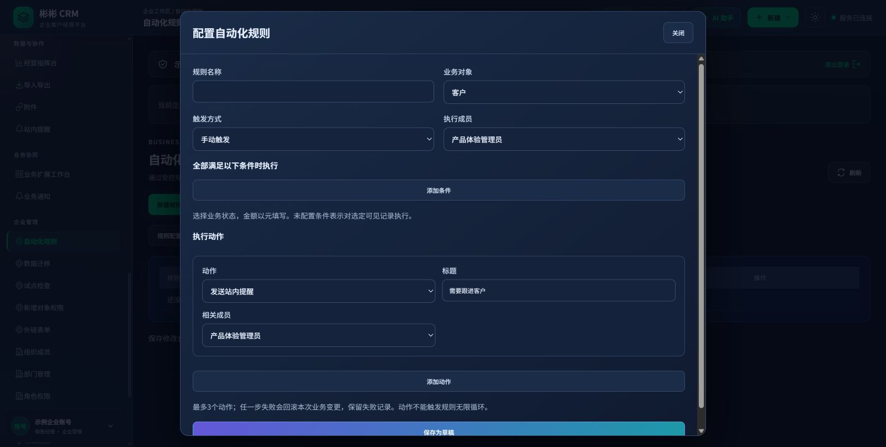

# P7 完整阶段交付记录

更新：2026-10-21。**P7 软件及线上预览已交付，版本 0.21.0，数据库 V28。** 正式邮件投递与实际客户试点签收仍待业务参与方完成。

## 已交付功能

- P7-A：11 类经营分析、筛选、图表下钻及受控导出。
- P7-B：条件、每日定时、手动规则；草稿/发布/停用、7 类受控动作、执行和失败历史、权限重验、事务回滚、幂等与防递归。
- P7-C：14 类业务资料工作区、扩展字段与附件、新对象权限、站内通知、签名读取接口与 Webhook 元数据事件、外链线索/服务需求表单、平台功能开关及额度、桌面/移动端适配。
- P7-D：7 类迁移模板、预校验与错误清单、整批入库与回滚、试点检查归档；V28 备份及实际隔离恢复演练。

## 操作入口

客户企业端：<https://crm-java-api-crm-test.up.railway.app/?account=owner>。

登录并选择企业后，从**左侧导航**进入“业务扩展工作台”“业务通知”“自动化规则”“数据迁移”“试点检查”“新增对象权限”“外链表单”。若页面此前一直开着，先刷新页面；仍显示旧导航时使用 Ctrl+F5。企业管理员还需具备相应业务角色。

平台运营端：<https://crm-java-api-crm-test.up.railway.app/?account=platform-operator>，进入“扩展功能套餐”。流程演示端使用浏览器数据，实际规则、迁移和检查记录在客户企业端办理。详见 [P7阶段开发交付](P7阶段开发交付.md)。

## 验收结果

应用代码 `a2fa0fc1035c8b3658e1cc5f96aadc9612791838` 的 Actions 第 50 次运行 `39399821273` 成功：前端 21 项；Java 60 项（59 成功、1 项字体相关跳过）；P6 API 26 项；P7-A API 30 项；P7 B–D API 50 项；P7-A 浏览器 6 项；P7 浏览器 11 项；备份测试 17 项；两类容器构建成功。

私有发布打包提交 `529bd6b` 的第 51 次运行成功。启动脚本修复 `65f4cdc9ddcb52d247950f7dd9fdee1d5a256adb` 的第 53 次运行 `39528195888` 也已成功。

实际部署 `51ded2ae-0ef6-4d81-8e8b-031673febe3d` 达到 SUCCESS，健康检查返回 UP / 0.21.0；V26–V28 三个迁移成功。14 项公开入口、前端资源哈希、未登录接口保护检查全部通过。复用已有登录会话只读核查了真实企业端的规则列表和弹窗、14 类工作区、7 类迁移模板与试点检查，未创建业务记录。

## 备份与恢复

备份服务部署 `8a5fe452-25a2-4731-b8dd-9960dbb47182` 保留每天 UTC 18:00（北京时间凌晨 2 点）的计划。2026-10-21 手动运行备份任务 `5856871e-3fb7-47df-8797-5cca1a4485b3` 成功：

- 加密文件 545346 字节；私有存储读回、认证解密和篡改拒绝均通过。
- 在新建的一次性 PostgreSQL 18 中恢复；127 张表、12108 行、103 张 RLS 表、28 个迁移、94 张业务表内容一致性及运行账号租户边界检查通过；检查后移除一次性恢复库。
- 当前无附件文件，本轮附件恢复计数为 0，不代表已经验证真实客户附件。
- 保留期 30 天，至少保留 3 份成功备份；本轮可用副本 10 份。密钥未更换。

完整机器可读证据见 [P7发布与备份核验记录](P7发布与备份核验记录.json)。

## 发布方式与运维记录

私有发布文件 SHA-256：`0a7af42f6eec196392614ba04fe7f3bcd0029906d94978c9a85d3547c314f947`。文件直接上传至已有私有存储并认证读回校验，旧发布分片保留，临时构件下载 URL 引用已清空。启动脚本使用已校验发布包中的明确 SQL 目录执行 Flyway，避免此次容器内未解析到打包迁移的问题。

平台仍报告历史镜像别名变更 `a19b69c0-2399-445b-b92e-757477a50dcb` 为 APPLYING；实际固定镜像部署、线上健康/资源/API 与备份均已验证成功。不要重复提交该历史变更；其状态残留仍需平台侧清理。

## 后续事项

当前示例企业“试点检查”为 6/14 就绪，独立复核人员、企业自身业务闭环演练、正式 SMTP 参数与实际投递、客户试用和签收仍待完成。隔离 CI 的业务演练不替代企业实际试点。下一开发阶段为二期 P8 AI 扩展，自定义组件设计器不在范围内。
