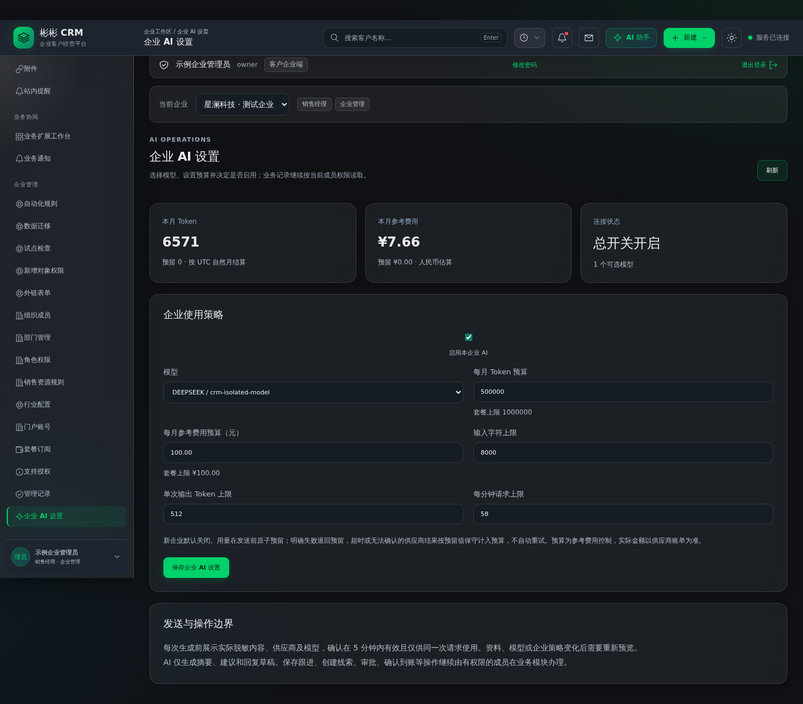

# P8-A：AI 平台底座

版本：0.22.0；数据库迁移 V29。软件及完整隔离验收已完成，发布包已准备。Railway 平台故障阻塞上线，实际线上仍是 0.21.0 / V28，本轮尚未完成 V29 云端备份恢复。

## 操作入口

- 产品方：使用平台运营账号，左侧进入「AI 模型与预算」。添加模型、人工录入人民币参考单价，设置套餐每月 Token 和参考费用上限。
- 客户企业：企业管理员从左侧进入「企业 AI 设置」，选择模型并设置企业预算、输入及输出上限、每分钟请求次数。新企业默认关闭。
- 使用成员：左侧「AI 助手」选择权限范围内的业务记录，点击「预览脱敏内容」，核对实际内容、供应商及模型后勾选同意，再生成建议。

## 已实现

按产品负责人确认，默认供应商选择 DeepSeek；保留 OpenAI、通义千问适配。DeepSeek 先采用非思考模式生成业务草稿，避免有限输出预算被推理过程耗尽。密钥只由产品方配置在服务器，不保存在模型表，不返回客户端。没有默认付费模型，不自动试调用。

每次预览的确认在五分钟内有效，仅绑定当前成员、业务上下文、模型和企业策略的版本。修改资料或配置后重新预览。同一请求编号重复提交返回同一记录，并发提交不会重复发送。反馈与历史结果跟随当前记录可见权限，跨企业禁止访问。

调用前在事务内原子预留月调用数、保守 Token 和参考费用。发送前再次检查会话、权限及配置。成功时按供应商用量结算；明确拒绝退回预留；超时、异常响应及用量未知按预留值保守计入，不自动重试。参考费用依据人工单价，不替代供应商账单，也不保证供应商真实费用上限。未完成的进程内请求仍保留预留，需人工核对供应商记录后处理，禁止盲目释放并重试。

手机号、邮箱、常见证件/账号及凭据模式应用于自由文本、补充要求和输出；模式脱敏不能识别全部商业秘密，发送前仍需人工核对。系统只取业务字段白名单，不发送附件、自定义字段和完整数据库行。AI 只返回建议，不调用业务写入工具，不执行审批、回款确认或自动创建客户。

新增全局模型表及两个强制租户 RLS 表；审计记录配置变更、预留、完成和费用不确定状态。V29 纳入备份及隔离恢复的结构校验。

## 服务配置

默认 `CRM_AI_ENABLED=false`。实际接入时配置对应的服务器密钥 `CRM_AI_OPENAI_API_KEY`、`CRM_AI_DEEPSEEK_API_KEY` 或 `CRM_AI_QWEN_API_KEY`，再启用总开关、平台模型及企业策略。原先 P4 单一供应商配置不自动开启本轮新策略。

OpenAI、DeepSeek 使用固定官方地址。千问默认中国大陆 DashScope 地址，可由产品方设置 `CRM_AI_QWEN_BASE_URL` 为受限官方地域/工作空间地址。禁止由客户录入任意接口地址。部署者需自行确认供应商可用地域、数据处理约定及账号额度。

隔离 CI 仅当 `acceptance` 配置与固定的非秘密测试凭据同时存在，才路由到本机合成供应商；正式环境不配置这两项。真实供应商密钥尚未提供，真实调用和账单核对不作为已完成事项。

协议依据：[OpenAI](https://developers.openai.com/api/reference/resources/chat/subresources/completions/methods/create)、[DeepSeek](https://api-docs.deepseek.com/api/create-chat-completion/)、[千问](https://www.alibabacloud.com/help/en/model-studio/qwen-api-via-openai-chat-completions)。价格由平台人工录入，本轮不内置易过期报价。

## DeepSeek 接入约定

产品方后续在服务器配置 `CRM_AI_DEEPSEEK_API_KEY`；平台「AI 模型与预算」默认选择 DeepSeek。接口为官方 `https://api.deepseek.com/chat/completions`，以 Bearer 认证发送 `messages`、`max_tokens`、`thinking.type=disabled` 和 `stream=false`。模型标识由平台配置，不写死在业务代码中，接入时依供应商账号可用模型填写。

本轮不需要真实 Key；没有 Key 时默认关闭，不产生真实调用费用。Token 统计、参考预算、发送前人工确认、脱敏和审计统一使用现有底座。P8-A 的隔离完整调用测试按 DeepSeek 协议执行，不代表已通过真实供应商联网验收。

## 后续

P8-B：销售场景的智能辅助。在接入真实供应商前，先完成小范围验收并核对脱敏内容、用量和费用。正式 SMTP 投递、实际客户试点及签收仍待参与方完成。

## 验收与发布状态

GitHub Actions [第 59 次运行](https://github.com/KevinZENG2/binbin-crm/actions/runs/39594818425) 对代码 `de18f4d7dcd3e08f72cd6244ce3c2efcf54a2ca1` 全部通过：前端 21 项；Java 72 项执行、71 通过、1 项字体条件跳过；P6 API 26 项、P7-A API 30 项、P7 API 50 项；P8-A DeepSeek 协议接口 26 项；P7-A 浏览器 6 项、P7 浏览器 11 项、P8-A 浏览器 5 项；备份测试 17 项；应用和备份两类容器构建成功。

P8-A 浏览器验证包含实际保存并刷新后仍保留输入值、390px 手机宽度、脱敏预览、独立平台模型入口以及无运行异常。真实供应商联网调用未执行，截图中的用量与参考金额均来自隔离合成资料。

发布包 SHA-256 为 `30e30e68a74ea201056aba07b3a7c1ab4bdbd95c221399e95d8c298e8a018969`，大小 494787 字节。归档中包含 V29。包尚未上传运行存储、未修改线上配置；实际发布及云端恢复验证待 Railway 恢复。下载构件到期后需重新运行或重新打包校验。

发布重试记录：管理接口已部分恢复，实际部署仍被平台暂停；备份兼容代码已写入待部署变量，当前运行部署未变化。新增部署传输保护与四项离线行为测试，详见 [P8 实施进度](P8实施进度.md)。
